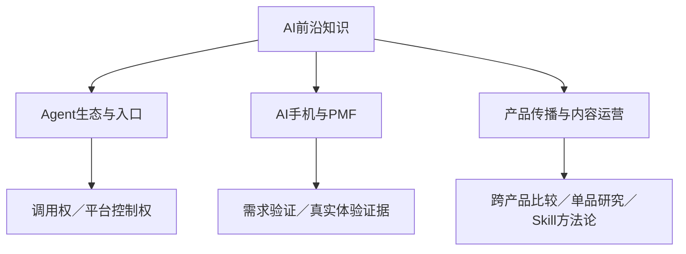

# AI 前沿知识库

按主题回顾行业研究、产品验证与传播实践；首页直接展示核心收获。

## 知识总览

主题内按已知记录时间从早到晚排列，同日保留相关资料顺序。日期优先采用笔记整理日期；B站报告采用原索引的报告生成时间，只有月份的条目不虚构具体日期，放在当月精确日期之前，不代表已确定其先后。迁移时间不作为创建时间。以下是现有文档的内容摘要，未重新验证原报告全部事实与数据；个人关注与文档分析分开标明。

## Agent生态与入口

| 笔记／报告 | 创建／整理／生成时间 | 核心启发 | 已有个人关注／思考 |
| --- | --- | --- | --- |
| [微信让路，但不让权](./文章分析/微信让路不让权_A2A协议与AI-Agent生态博弈分析.md) | 2026-07-12 | 原笔记从调用权、身份、关系链和支付控制权，分析入口前移后的平台博弈。 | 原笔记延伸：分析Agent竞争时同时看入口和平台规则。 |

## AI手机与PMF

| 笔记／报告 | 创建／整理／生成时间 | 核心启发 | 已有个人关注／思考 |
| --- | --- | --- | --- |
| [AI手机PMF与系统级Agent](./文章分析/2026-10-14_AI手机PMF_豆包_STEPX与系统级Agent.md) | 2026-10-14 | AI助手的持续委托价值，与驱动换机或溢价的AI手机价值，需要分别验证。 | 已有关注：销量、持续使用证据、能力不足与产品设计。 |
| [AI手机真实用户反馈](./文章分析/2026-10-14_AI手机真实用户反馈_证据台账.md) | 2026-10-14 | 能完成任务不等于更快；版本、权限、连续性和人工监督都会影响体验。 | 已有要求：真实体验必须能追溯原始链接；样本不足不能外推满意度。 |

## AI产品传播与内容运营

| 笔记／报告 | 创建／整理／生成时间 | 核心启发 | 已有个人关注／思考 |
| --- | --- | --- | --- |
| [Codex-B站传播策略洞察报告](./文章分析/bilibili/2026-08-Codex-B站传播策略洞察报告.html) | 2026-08（具体日期待核实） | 教程、安装和实战构成不同内容层次；标题以明确受众、成果和资料降低理解门槛。 | 未单独记录个人感悟。 |
| [Trae-B站传播策略洞察报告](./文章分析/bilibili/2026-08-Trae-B站传播策略洞察报告.html) | 2026-08（具体日期待核实） | 从头部内容、卖点与选题结构，研究产品如何触达开发者。 | 未单独记录个人感悟。 |
| [B站洞察Skill方法论文章](./文章分析/bilibili/2026-08-B站洞察Skill方法论文章.html) | 2026-08（具体日期待核实） | 将采集、分析和报告形成可复用流程，重点是把数据转成可执行的内容建议。 | 未单独记录个人感悟。 |
| [AI代码产品-B站传播策略洞察报告](./文章分析/bilibili/2026-08-AI代码产品-B站传播策略洞察报告.html) | 2026-08-28 | 横向比较六款产品的内容主题、卖点与作者结构；搜索样本与关键词分类存在限制。 | 未单独记录个人感悟。 |
| [WorkBuddy-B站传播策略洞察报告-初版](./文章分析/bilibili/2026-08-WorkBuddy-B站传播策略洞察报告-初版.html) | 2026-08-28 | WorkBuddy传播基础分析框架，作为报告演进记录保留。 | 未单独记录个人感悟。 |
| [WorkBuddy-B站传播策略洞察报告-完整版](./文章分析/bilibili/2026-08-WorkBuddy-B站传播策略洞察报告-完整版.html) | 2026-08-29 | 在基础分析上补充数据修正、内容设计、卖点文案和TOP5爆款拆解，优先阅读本版。 | 未单独记录个人感悟。 |

## 行业研究与价值信息

| 资料 | 收录时间 | 收录价值／状态 |
| --- | --- | --- |
| [重要行业资料（待补全文）](./文章分析/行业研究/2026-10-29_重要行业资料_B12z3pQyqoZWpUDB5Nz-dw.md) | 2026-10-29 | 指定为重要行业价值信息；已收藏原始链接，标题、正文和细分主题待补，尚未形成研究结论。 |

## 阅读与维护

- WorkBuddy优先阅读完整版，初版保留演进记录；[B站报告版本与来源](./文章分析/bilibili/README.md)。
- 数据采集时间、报告生成时间、笔记创建时间分别保留，后续确认原始创建时间再补齐。
- 研究结论以各篇的证据范围和版本为界；播放量不直接代表产品份额或转化效果。
- 新内容同步登记主题、日期、核心启发及明确记录的个人思考，并附原始来源。
